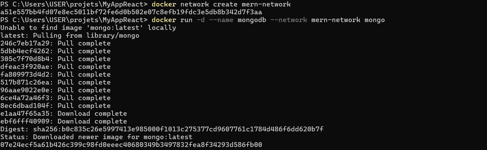
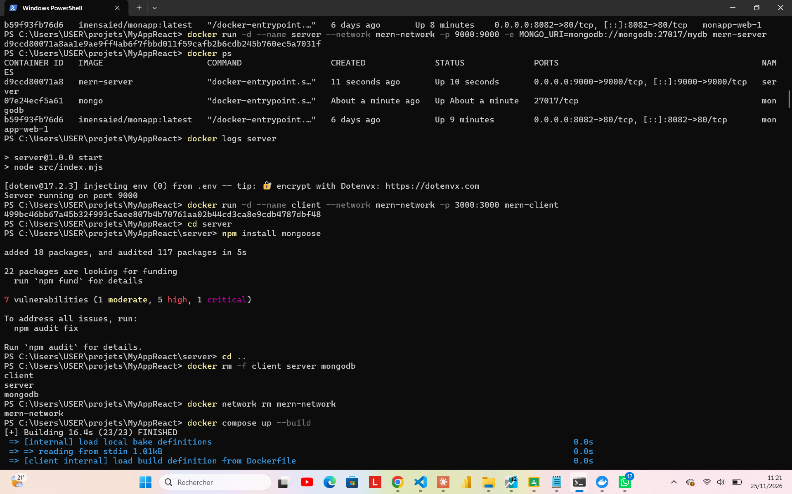
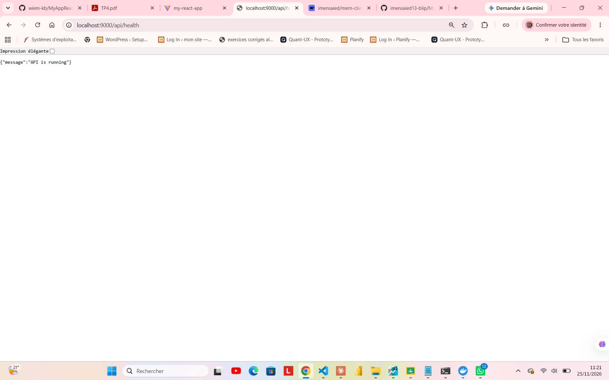
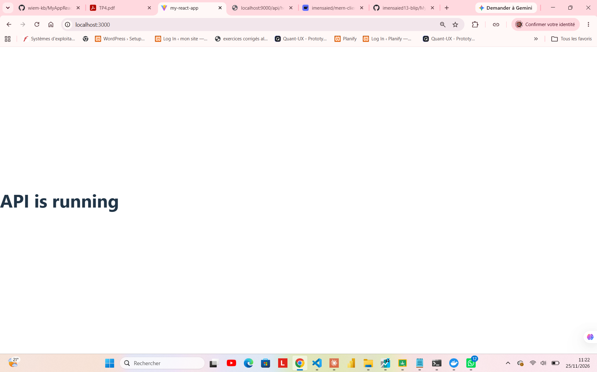
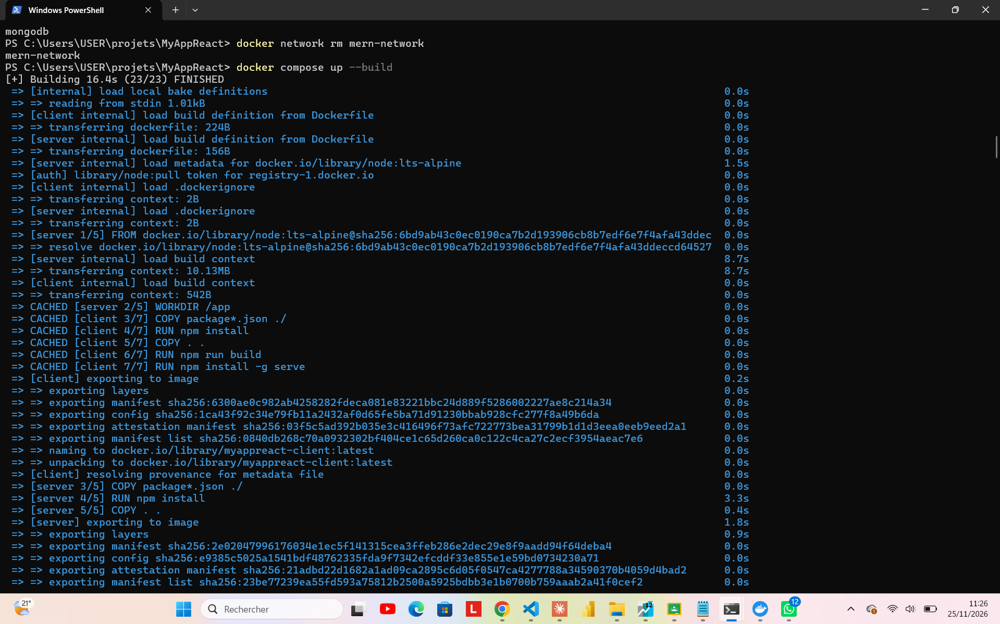
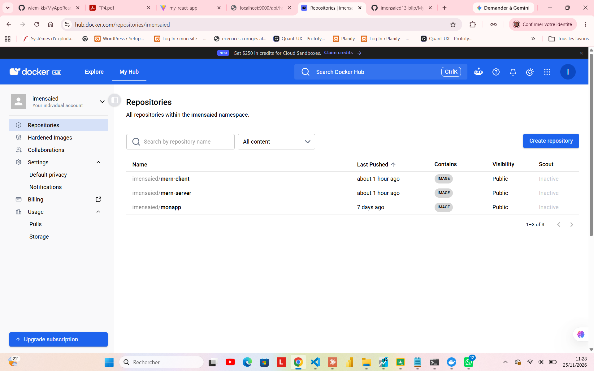

# TP4 : Docker et Docker Compose - Application MERN

## Structure du projet

```
MyAppReact/
├── client/            # Application React (Vite)
│   ├── Dockerfile
│   └── .dockerignore
├── server/            # API Express
│   ├── Dockerfile
│   ├── .dockerignore
│   └── src/index.mjs
├── docker-compose.yml
└── README.md
```

## Étapes réalisées

### 1. Cloner le projet


git clone https://github.com/wiem-kb/MyAppReact.git
cd MyAppReact
### Erreur li ṭla3tli : "chemin introuvable"

Ki 3malt cd Desktop, tla3li erreur chemin introuvable. 5ater dossier Desktop mouch fi nafs el blasa li kont fiha fil terminal donc sna3t dossier jdid fil home mte3i w 3malt fih el clone :
cd ~
mkdir projets
cd projets
git clone https://github.com/wiem-kb/MyAppReact.git
cd MyAppReact


### 2. Créer les Dockerfiles

- **Pour le serveur (Express) :**
— Créez un fichier Dockerfile dans le dossier server.
— Nom de l’image : mern-server
— Instructions à inclure dans le Dockerfile :
— Utiliser l’image de base node:lts-alpine.
— Définir le répertoire de travail dans le conteneur.
— Copier les fichiers package*.json.
— Installer les dépendances avec npm install.
— Copier le reste des fichiers du serveur.
— Exposer le port 9000.
— Démarrer l’application avec npm start.
 **Commande pour construire l’image du serveur :**
— docker build -t mern-server ./server
- **Pour le client (React) :** 
— Créez un fichier Dockerfile dans le dossier client.
— Nom de l’image : mern-client
— Instructions à inclure dans le Dockerfile :
— Utiliser l’image de base node:lts-alpine.
— Définir le répertoire de travail dans le conteneur.
— Copier les fichiers package*.json.
— Installer les dépendances avec npm install.
— Copier le reste des fichiers du client.
— Construire l’application React avec npm run build.
— Installer un serveur HTTP léger (par exemple, serve).
— Exposer le port 3000.
— Démarrer le serveur pour servir les fichiers de build.
  **— Commande pour construire l’image du client :**
  $ docker build -t mern-Client ./client

### Erreur: ghalta fil enoncé esm el image mta3 el client:

fel PDF  el commande mta3 el client hakka : docker build -t mern-server ./client. Hedhi ghalta, Esta3malt mern-client 

### 3. Créer le réseau Docker:
docker network create mern-network
### 4. Exécuter MongoDB dans un conteneur:
docker run -d --name mongodb --network mern-network mongo


### 5. Exécuter les conteneurs du serveur et du client
 ### Pour le serveur :
docker run -d --name server --network mern-network -p
9000:9000 mern-server
 ### Pour le client :
docker run -d --name client --network mern-network -p
3000:3000 mern-client

Zedt -e MONGO_URI=... fi commande mta3 el server (el PDF ma ykteb-hech) bech el server ye3ref win MongoDB.

Erreur 3 : el server ma yconnectich l MongoDB

Ki 9rit docker logs server, tla3li bark :

Server running on port 9000

w ma tla3ch "MongoDB connected". Ki fta7t Server/src/index.mjs l9it el code ma fihch mongoose w ma yesta3mlch MONGO_URI, ya3ni el server yekhdem (Express) ama ma yconnectich l MongoDB.

El 7all :

Installit mongoose fil dossier Server :
powershell
cd Server
npm install mongoose
cd ..
Zedt fi index.mjs el connexion b MONGO_URI :
javascript
import mongoose from 'mongoose';

mongoose
  .connect(process.env.MONGO_URI)
  .then(() => console.log('MongoDB connected'))
  .catch((err) => console.error('MongoDB connection error:', err.message));
Rebuild w relanci :
powershell
docker rm -f server
docker build -t mern-server ./Server
docker run -d --name server --network mern-network -p 9000:9000 -e MONGO_URI=mongodb://mongodb:27017/mydb mern-server
docker logs server

Tawa el logs yetla3 fihom MongoDB connected w Server running on port 9000.



El test fil navigateur
http://localhost:3000 : yetla3 el application React.
http://localhost:9000/api/health : yetla3 {"message":"API is running"}.




### 6. Créer un fichier Docker Compose du projet :
Sna3t docker-compose.yml fil racine :
— mongodb : Utiliser l’image mongo, nommer le conteneur mongodb, le
connecter au réseau mern-network.
— server : Construire à partir du dossier ./server, nommer le conte-
neur server, exposer le port 9000, le connecter au réseau mern-network,

dépendre de mongodb, définir la variable d’environnement MONGO_URI

— client : Construire à partir du dossier ./client, nommer le conte-
neur client, exposer le port 3000, le connecter au réseau mern-network,

dépendre de server.
— Définir le réseau mern-network avec le driver bridge.
### kif haka: 
services:
  mongodb:
    image: mongo
    container_name: mongodb
    networks:
      - mern-network

  server:
    build: ./Server
    container_name: server
    ports:
      - "9000:9000"
    environment:
      - MONGO_URI=mongodb://mongodb:27017/mydb
    depends_on:
      - mongodb
    networks:
      - mern-network

  client:
    build: ./Client
    container_name: client
    ports:
      - "3000:3000"
    depends_on:
      - server
    networks:
      - mern-network

networks:
  mern-network:
    driver: bridge

### Commande pour lancer l’application avec Docker Compose :
docker compose up --build

### Livrables: 
### Etape 7 : Docker Hub: push mta3 les images :
docker login
docker tag mern-server imensaied/mern-server:latest
docker tag mern-client imensaied/mern-client:latest
docker push imensaied/mern-server:latest
docker push imensaied/mern-client:latest




Etape 8 : GitHub

Sna3t repo jdid fil GitHub (imensaied13-blip/MyAppReact), w b3athna el projet.

powershell
git remote -v
git remote remove origin
git remote add origin https://github.com/imensaied13-blip/MyAppReact.git
git add .
git commit -m "TP4 Docker et Docker Compose"
git branch -M main
git push -u origin main


### Erreur : node_modules tab3ath lel GitHub

 node_modules yetsna3 men jdid b npm instal ama  ma yetb3athch lil GitHub.
donc 
### Sna3t .gitignore fil racine :
node_modules
dist
.env
Nahit node_modules men git 
powershell
git rm -r --cached Server/node_modules
git rm -r --cached Client/node_modules
git add .
git commit -m "Remove node_modules and add .gitignore"
git push

Screenshot : github


Etape 9 : Jenkins (pipeline)

A compléter : zid houni installation mta3 Jenkins, el Jenkinsfile, w el captures mta3 el pipeline.

groovy
// Jenkinsfile (a zid houni)

Screenshots : jenkins-pipeline jenkins-result

Résumé des erreurs w el 7all
Erreur	El sbab	El 7all
cd Desktop : chemin introuvable	Desktop mouch fi el blasa li kont fiha	Sna3t dossier projets fil home
docker build -t mern-server ./client	Ghalta fil PDF, tkhalli image tet3ayet mern-server	Esta3malt mern-client
CMD serve -s build ma yekhdemch	El projet Vite, el dossier esmou dist	Baddelt el CMD l dist
MongoDB connected ma tla3ch	El code ma fihch mongoose w MONGO_URI	npm install mongoose + zedt mongoose.connect(process.env.MONGO_URI)
node_modules tab3ath lel GitHub	Ma kenech fama .gitignore	Sna3t .gitignore w git rm -r --cached
./server ma yetla9ech fil Linux	Linux yfarreq bin majuscule w minuscule	Baddelt l ./Server w ./Client
El commandes el mohemma
powershell
docker compose up --build     # lanci el application
docker compose ps             # chouf el containers
docker compose down           # waqqaf kol chay
docker logs server            # logs mta3 el server
docker images                 # chouf les images

### 3. Créer le réseau Docker

docker network create mern-network


### 4. Exécuter MongoDB dans un conteneur

docker run -d --name mongodb --network mern-network mongo

### 5. Lancer le serveur et le client

```bash
docker run -d --name server --network mern-network -p 9000:9000 -e MONGO_URI=mongodb://mongodb:27017/mydb mern-server
docker run -d --name client --network mern-network -p 3000:3000 mern-client
```

Le serveur se connecte à MongoDB grâce à la variable d'environnement `MONGO_URI` (le nom `mongodb` est résolu par le réseau Docker).

### 6. Docker Compose

Le fichier `docker-compose.yml` définit trois services (`mongodb`, `server`, `client`) et le réseau `mern-network` (driver bridge). Le serveur dépend de `mongodb` et le client dépend du serveur.

Avant de lancer Compose, supprimer les conteneurs manuels :

```bash
docker rm -f client server mongodb
docker network rm mern-network
```

Lancement :

```bash
docker compose up --build
```

Arrêt :

```bash
docker compose down
```

## Accès

- Client React : http://localhost:3000
- API Express : http://localhost:9000/api/health